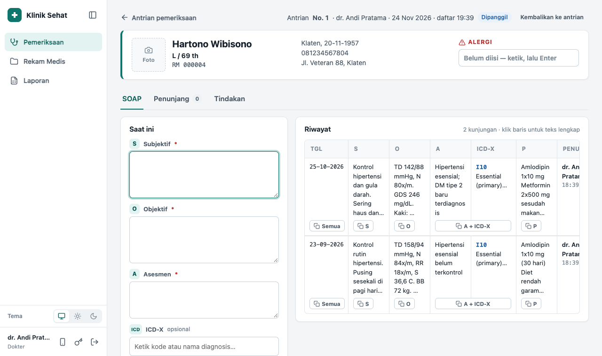
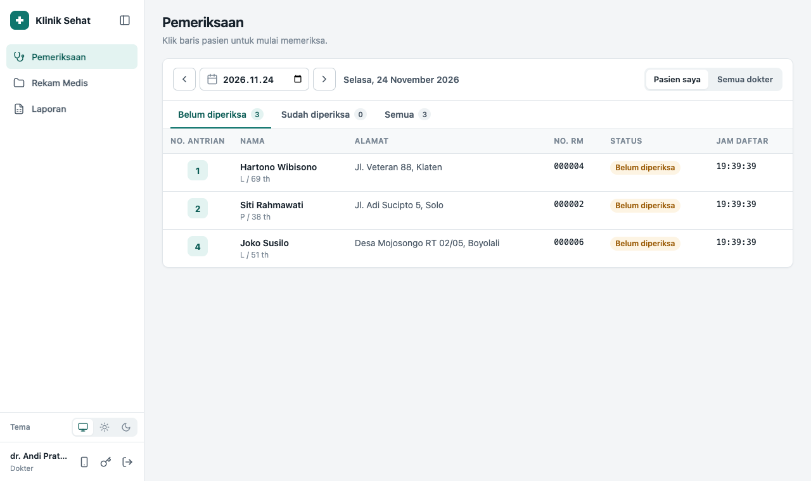

# Simple EMR

A multi-user, role-based electronic medical record (Rekam Medis Elektronik) for a small clinic.
The UI is in Indonesian. It runs on a Linux server with Docker Compose (Django + PostgreSQL), and
every asset ships with the app, so it also works on a clinic LAN with no internet access.

> **Before using it with real patients:** this software comes without warranty and is not a certified
> medical device. You are responsible for backups, HTTPS, access control and the health-data rules that
> apply to your clinic. Never put real patient data in issues, pull requests or tests.





<sub>Screenshots show fictional demo data.</sub>

## What it does

| Menu | Purpose |
| --- | --- |
| **Pendaftaran** | Daily list of registered patients (date picker, tabs *Belum diperiksa / Sudah diperiksa / Semua*). **Daftar baru** (or **F2**) opens the registration form: search by name, RM, NIK, address or phone → pick the patient (**Ubah** next to *Pilih* corrects their data first), or create a new one (No. RM is generated automatically) → choose the doctor (the photo square on this step takes or replaces the patient's photo; **Cetak kartu** prints their patient card) → back to the list with a queue number. If a returning patient has no NIK, a pop-up asks for it; it can be skipped and appears again on the next visit. **Scan kartu** next to the search box reads the QR on the patient card with the webcam and picks that patient straight away. A USB barcode scanner works too, without HTTPS: scan the card anywhere on this page (or into the search box). |
| **Pemeriksaan** | The doctor's queue (own patients or all doctors). Click a row to examine: identity box (patient photo, sex / age calculated from date of birth, place and date of birth, phone, address, editable **ALERGI** field), **SOAP** tab with the current note (S, O, A, P required; ICD-X optional as searchable cards) next to the patient's history (Tgl, S, O, A, ICD-X, P). Each history row has copy buttons for S, O, P, one combined button for A + ICD-X, and "Semua". **Tindakan** tab: procedures performed (ICD-9-CM, optional, searchable cards like ICD-X) next to the procedure history (Tgl, ICD-9-CM, Penulis) with a copy button per visit; they are saved together with the SOAP note (save button on either tab, or Ctrl+S). Unsaved notes and procedures are kept as a draft in the browser. |
| **Rekam Medis** | The full patient database (No. RM, Nama, Alamat, NIK). Double-click a row to open the patient's history (SOAP and Tindakan) and ancillary results, or edit identity data. **Cetak kartu** prints the patient card. |
| **Kartu periksa** | The patient card, the size of a bank card (85.6 × 54 mm), filled in from the record: practice letterhead (`KARTU_*` in `.env`) with a QR code in the top-left corner, then MR, Nama, Tgl. Lahir and Alamat (RT / RW included when they are part of the address). The QR holds `RM:` + the No. RM, nothing else. It uses the highest error correction (H, about 30 % can be damaged) and is printed upside down, so the corner that chips first holds repairable data rather than one of the three big squares readers locate it by; readers read it at any angle. *Cetak kartu* opens it in a new tab and starts printing. Paper, remembered per PC: *Kartu 85,6 × 54 mm* for a card printer or card-sized stock, or *A4* (the card at real size in the top-left corner with a thin line to cut along). Print at 100 % scale with headers and footers off. Long names wrap to two lines and long addresses shrink to fit. |
| **Patient photo** | The square left of the name in the identity box (Pemeriksaan and Rekam Medis) and on the *Pilih dokter* step of registration. Click it to see the photo large, take one with the webcam (*Kamera* → *Ambil foto* → *Simpan foto*; pick the camera if the PC has several), upload a picture, or delete it. Photos are stored as JPEGs of at most 800 px; a new photo replaces the old file. The webcam needs HTTPS (see below). |
| **Penunjang** tab | Ancillary results (EKG, lab, radiology, other) for a patient: drag and drop photos or PDFs, take a photo, page numbers with newest first, reorder with ⠿ or ← →, notes, rotate, change category, delete, full-screen viewer. JPEG/PNG/WebP/HEIC photos are converted to compact JPEGs; PDFs get a cover thumbnail. |
| **Upload via HP** | A phone-only page (`/m/`) that does one thing: pick a patient (today's list or search) and photograph results into their chart. On the desktop Penunjang tab, **Upload via HP** shows a QR code that opens this page for that patient; new photos appear on the desktop automatically. Logging in from a phone lands here directly. |
| **Laporan** | Monthly DM / HT report for the Puskesmas (*Jejaring Fasyankes Swasta*): pick the month, the doctor (DPM), the Puskesmas name and the age range (15–59 by default), check the list on screen, then **Unduh Excel**. A patient is listed when one of that doctor's finished visits in the month has ICD-X **E11** (DM, including E11.0–E11.9) or **I10** (HT) and the patient's age on that day is in the range. *Faktor resiko* shows every DM/HT code in the patient's history up to the end of the month, so a diabetic seen for hypertension reads "DM, HT". Patients without a date of birth are left out and named above the list so they can be completed. |
| **Pengguna** | Admins create accounts, assign roles, reset passwords and deactivate staff. |

The theme switch at the bottom of the sidebar (and the icon next to *Keluar* on the phone page)
picks *Otomatis* (follow the device), *Terang* or *Gelap*. The choice is remembered per browser.

Every login, chart opening, registration, SOAP save (with full content), allergy change, photo change, upload and
printed patient card is written to an audit log (viewable at `/admin/`). Deleting a result page hides it but keeps the file.

### Roles

A user can hold several roles (for example a doctor who is also the admin).

| | Admin | Dokter | Perawat | Pendaftaran |
| --- | :-: | :-: | :-: | :-: |
| Register patients / manage queue | ✓ | | ✓ | ✓ |
| Open the examination queue | ✓ | ✓ | ✓ | |
| Write SOAP / ICD-X / Tindakan, call patients | | ✓ | | |
| Read SOAP history | ✓ | ✓ | ✓ | |
| Patient database, edit identity | ✓ | ✓ | ✓ | ✓ |
| Edit allergy | ✓ | ✓ | ✓ | |
| View / upload ancillary results, phone upload page | ✓ | ✓ | ✓ | |
| Monthly DM / HT report (Laporan, Excel) | ✓ | ✓ | ✓ | |
| Manage users, `/admin/` | ✓ | | | |

**Changing roles.** Everything about roles is in [`core/permissions.py`](core/permissions.py):

- `ROLES` is the list shown as checkboxes on the Pengguna form (key → label, description).
  To add a role, add a line there; to remove one, delete its line. Its group in the database is
  created automatically on the next start.
- `PERMS` says which roles may do what. Add the new role's key to the sets it needs, and delete a
  removed role from them (the container log warns about leftovers).
- `admin` and `dokter` are built in and must stay (their labels can be changed).

Code changes take effect after `docker compose up -d --build`; editing files on the server without
rebuilding changes nothing in the running container.

When the doctor opens a patient, the visit shows as **Dipanggil** (with the time) on every queue
screen; *Kembalikan ke antrian* on the examination page undoes it. Queue lists update by
themselves within a few seconds when a patient is registered, called, examined or cancelled.

## Install on a Linux server

Requirements: Docker Engine with the Compose plugin.

```bash
git clone <this repo> simple-emr && cd simple-emr
cp .env.example .env
nano .env        # set CLINIC_NAME, DJANGO_SECRET_KEY, POSTGRES_PASSWORD, ADMIN_PASSWORD
docker compose up -d --build
```

Open `http://<server-ip>:8000` and log in with `ADMIN_USERNAME` / `ADMIN_PASSWORD`. Then, under
**Pengguna**, create accounts for doctors (role *Dokter*, display name such as "dr. Andi Pratama"),
nurses and front-desk staff. Doctors only appear in the registration form once they have the
*Dokter* role.

On first start the container migrates the database, creates the admin account and loads a starter
list of ~235 common primary-care ICD-10 codes. Diagnoses are shown and saved with their official
English WHO titles (ICD-10 2019 wording); each code also carries hidden Indonesian search words, so
typing "hipertensi" or "diare" still finds I10 or A09. It also loads ~130 common primary-care
ICD-9-CM procedure codes for the Tindakan tab (official English titles, Indonesian search words such
as "jahit luka", "nebulisasi" or "ekstraksi kuku").

### Configuration (`.env`)

| Variable | Meaning |
| --- | --- |
| `CLINIC_NAME` | Shown in the sidebar, login page and browser tab. |
| `PUSKESMAS_NAME` | Puskesmas the monthly DM / HT report goes to (e.g. `Contoh`); pre-filled on the Laporan page. |
| `KARTU_NAMA`, `KARTU_ALAMAT`, `KARTU_WA` | Letterhead of the printed patient card: practice name (default `CLINIC_NAME`), address line, WhatsApp number (shown with a WhatsApp logo). An empty line is left out. |
| `DJANGO_SECRET_KEY` | Long random string (`openssl rand -base64 48`). Keep it secret. The app refuses to start while it is `change-me`. |
| `DJANGO_ALLOWED_HOSTS` | Host names/IPs the app answers on. `*` is fine on a closed LAN. |
| `COMPOSE_PROFILES`, `EMR_HOST`, `EMR_TLS` | HTTPS through the bundled Caddy (see *HTTPS* below). |
| `DJANGO_HTTPS` | `1` when served through your own HTTPS reverse proxy (sets secure cookies). |
| `DJANGO_CSRF_TRUSTED_ORIGINS` | Behind HTTPS, the public origin, e.g. `https://emr.klinik.id`. |
| `POSTGRES_PASSWORD` | Database password (used by both containers). |
| `ADMIN_USERNAME`, `ADMIN_PASSWORD` | First admin, created only if no admin exists. The password `change-me` is refused. |
| `WEB_PORT` | Port users open in the browser (default 8000). The container itself always listens on 8000, so `docker ps` shows `0.0.0.0:<WEB_PORT>->8000/tcp`. |
| `PASSWORD_MIN_LENGTH` | Minimum password length (8; `0` = none). |
| `PASSWORD_BLOCK_COMMON`, `PASSWORD_BLOCK_ALL_NUMERIC`, `PASSWORD_BLOCK_SIMILAR_TO_NAME` | `1`/`0`: reject common passwords, digits-only passwords, passwords close to the username (all on by default). |
| `PASSWORD_REQUIRE_DIGIT`, `PASSWORD_REQUIRE_UPPERCASE`, `PASSWORD_REQUIRE_SYMBOL` | `1`/`0`: require a digit, a capital letter, a symbol (all off by default). The active rules are listed under the password field. |
| `PUBLIC_BASE_URL` | Address phones use for the QR link, if different from the desktop's (e.g. `http://192.168.1.10:8000`). With `EMR_HOST` it defaults to `https://` + the IP listed there. |
| `TIME_ZONE` | Default `Asia/Jakarta` (use `Asia/Makassar` / `Asia/Jayapura` for WITA / WIT). |
| `MAX_UPLOAD_MB`, `RM_DIGITS` | Upload size limit per file (25), RM number length (6 → `000123`). |

After editing `.env`, run `docker compose up -d`: it recreates the containers with the new values.
`docker compose restart` keeps the old ones.

### HTTPS

Medical data should not travel over plain HTTP outside a trusted LAN, and browsers only allow the
webcam (patient photos, scanning patient cards) on HTTPS pages. The compose file includes Caddy, which serves the app over
HTTPS on ports 80/443; it starts only when switched on in `.env`.

**On a clinic LAN** (opened by server name or IP address, no internet domain):

1. Give the server a fixed IP (a DHCP reservation in the router), e.g. `192.168.1.10`.
2. In `.env`, uncomment and fill in:
   ```
   COMPOSE_PROFILES=https
   EMR_HOST=serverkliniksehat, 192.168.1.10
   EMR_TLS=internal
   ```
   `EMR_HOST` lists every address people type: here the server's computer name (which Windows PCs
   find on the LAN by themselves) and its IP (which phones need, since many cannot find a bare
   name). Each gets a certificate. It also turns on secure cookies, trusts logins from each address
   and puts the IP in the phone QR code, so `DJANGO_HTTPS` / `DJANGO_CSRF_TRUSTED_ORIGINS` /
   `PUBLIC_BASE_URL` can stay unset.
3. `docker compose up -d`, and open port 443 (and 80) in the server firewall if it has one
   (`sudo ufw allow 80,443/tcp`).
4. Caddy signs its own certificate, so every PC and phone must trust Caddy's root certificate once.
   Copy it off the server:
   ```bash
   docker compose cp caddy:/data/caddy/pki/authorities/local/root.crt ./emr-root.crt
   ```
   - Windows (Chrome / Edge): double-click `emr-root.crt` → *Install Certificate* → *Local Machine* →
     *Place all certificates in the following store* → *Trusted Root Certification Authorities*;
     restart the browser.
   - Android: Settings → Security → Encryption & credentials → Install a certificate → CA certificate.
   - iPhone: open the file to install the profile, then Settings → General → About → Certificate
     Trust Settings → turn it on.

   Until then the browser warns "Your connection is not private" and keeps the webcam blocked.
   The root certificate stays valid for about 10 years (it lives in the `caddy-data` volume; keep
   that volume, or every device needs the new one); Caddy renews the server certificate by itself.
5. Everyone opens `https://serverkliniksehat` (or `https://192.168.1.10`) from now on. Old
   bookmarks such as `http://serverkliniksehat:8000/pendaftaran/` still work: the app sends them to
   the same page over HTTPS (for the addresses listed in `EMR_HOST`).

**With a domain reachable from the internet** (DNS pointing at the server, ports 80 and 443
forwarded to it): set `EMR_HOST=emr.klinik.id` and `EMR_TLS=` your email address. Caddy then gets a
free Let's Encrypt certificate and nothing needs installing on the devices.

**Your own reverse proxy** instead: leave `COMPOSE_PROFILES` / `EMR_HOST` unset, proxy to port 8000,
and set `DJANGO_HTTPS=1` and `DJANGO_CSRF_TRUSTED_ORIGINS=https://emr.klinik.id`.

Without HTTPS, the photo dialog explains why the webcam is blocked and offers *Unggah foto* instead;
phones still get their camera app through the file picker. *Scan kartu* says the same; a USB barcode
scanner still reads patient cards, since it types like a keyboard. A single front-desk PC can be allowed
anyway in Chrome or Edge: open `chrome://flags/#unsafely-treat-insecure-origin-as-secure` (Edge:
`edge://flags/#unsafely-treat-insecure-origin-as-secure`), add `http://<server-ip>:8000`, enable it
and restart the browser.

### Full ICD-10 / ICD-9-CM list

The bundled list covers common diagnoses only. To load a complete list (for example the one your
BPJS / SIMRS uses), export it as CSV with the columns code, name (the English title) and,
optionally, alias (extra search words, never shown), and run:

```bash
docker compose cp icd10.csv web:/tmp/icd10.csv
docker compose exec web python manage.py load_icd10 /tmp/icd10.csv
```

Existing codes are updated, new ones added. Add `--replace` to drop everything not in the file.
Codes can also be edited at `/admin/`. Free-text diagnoses are always possible in the SOAP form.

Procedure codes (Tindakan) work the same way with `load_icd9` and a CSV of ICD-9-CM codes written
with the dot (`86.59`); free-text procedures are possible too.

```bash
docker compose cp icd9cm.csv web:/tmp/icd9cm.csv
docker compose exec web python manage.py load_icd9 /tmp/icd9cm.csv
```

### Import from MedPP (Program Pasien Praktek)

Patients and visit notes from the old MedPP program can be brought over. Close MedPP first, then
copy `pasien.dbf`, `rm.dbf` and `daftar.dbf` (and `ICD.DBF` if you want its codes) from the MedPP
folder to the server, for example into `~/medpp/`. Create the doctor's account under **Pengguna** first: old
visits are filed under that doctor.

```bash
docker compose cp ~/medpp web:/tmp/medpp
docker compose exec web python manage.py import_medpp /tmp/medpp --dry-run   # check only, saves nothing
docker compose exec web python manage.py import_medpp /tmp/medpp             # import
docker compose exec -u root web rm -rf /tmp/medpp
```

Add `--dokter <username>` when more than one account has the *Dokter* role, and `--icd` to add the
ICD-10 codes from `ICD.DBF` that are not in the list yet (existing names are kept).

What is imported:

| MedPP | Simple EMR |
| --- | --- |
| `pasien.dbf`: RM number, name, sex, date of birth, address, job, allergy, phone | Patient, **keeping the old RM number** (new patients continue with the usual numbers). A NIK typed as an address line is moved to the NIK field, unless the same NIK appears on more than one patient. |
| `daftar.dbf`: first registration | The patient's registration date, so **Rekam Medis** (sorted by *No. RM*, newest first) lists old and new patients in the order they were registered. Without the file, the date of the first visit note is used. |
| `rm.dbf`: Anamnesa, Periksa, Diagnosa, Pengobatan | A finished visit with S, O, A, P. Referral (*Rujuk*), therapy note, follow-up date and attachment path are added as lines under P; an ICD code becomes the visit's ICD-X. Empty rows (registration only) are skipped. |

Billing items, appointments (`janji.dbf`), stock and the old daily queues are not imported.

The import can be run again, for example to pick up visits typed into MedPP after the first run.
Visits that were imported before and patients that already exist (by RM number) are skipped, so
corrections made in Simple EMR are never overwritten (and later corrections in MedPP are not copied).

At the end it lists records to check: missing or impossible dates of birth (left empty, not
guessed), missing sex or address, shared NIKs, and visits whose patient is not in `pasien.dbf`. The
patient form asks for the missing fields the next time the record is edited.

## Operations

**Backup** (database + uploaded files) — run daily from cron and copy the files off the server:

```bash
docker compose exec -T db pg_dump -U emr -Fc emr > emr-$(date +%F).dump
docker run --rm -v simple-emr_media:/media -v "$PWD":/backup alpine tar czf /backup/media-$(date +%F).tgz -C /media .
```

**Restore**:

```bash
docker compose exec -T db pg_restore -U emr -d emr --clean --if-exists < emr-2026-10-30.dump
docker run --rm -v simple-emr_media:/media -v "$PWD":/backup alpine tar xzf /backup/media-2026-10-30.tgz -C /media
```

**Update** to a new version: `git pull && docker compose up -d --build` (migrations run automatically).

**Logs**: `docker compose logs -f web`.

## Development

```bash
python -m venv .venv && . .venv/bin/activate
pip install -r requirements.txt
export DJANGO_DEBUG=1          # without POSTGRES_HOST it uses SQLite in ./data/
python manage.py migrate
python manage.py ensure_admin  # uses ADMIN_USERNAME / ADMIN_PASSWORD, or prints a generated password
python manage.py load_icd10
python manage.py load_icd9
python manage.py seed_demo     # optional demo users, patients and history (never on production)
python manage.py runserver
python manage.py test core
```

Layout: `core/models.py` (patients, visits, diagnoses, procedures, ancillary pages, audit log),
`core/views/` (one module per menu), `core/templates/core/`, `core/static/core/` (one CSS file and
plain JavaScript, no build step; the patient card has its own `kartu.css`). `core/static/core/vendor/jsQR.js`
is [jsQR](https://github.com/cozmo/jsQR) 1.4.0 (Apache-2.0, licence alongside), the QR reader for browsers
without a built-in one (Chrome / Edge on Windows); it is loaded only when *Scan kartu* needs it.

## License

[MIT](LICENSE). Third-party parts keep their own terms: jsQR is Apache-2.0 (see
`core/static/core/vendor/jsQR.LICENSE.txt`), and the ICD-10 titles in `core/data/icd10_umum.csv` are
© World Health Organization and not covered by the MIT license.
